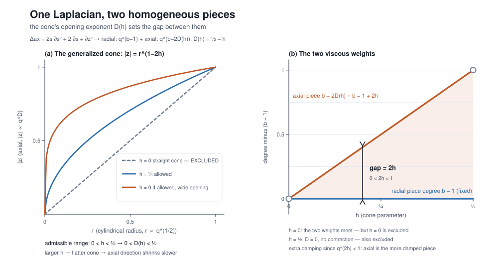
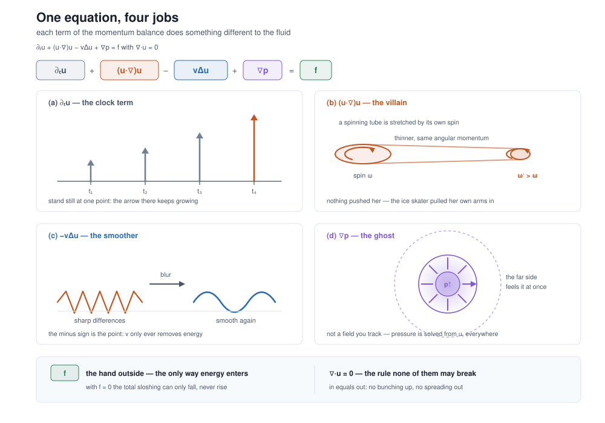
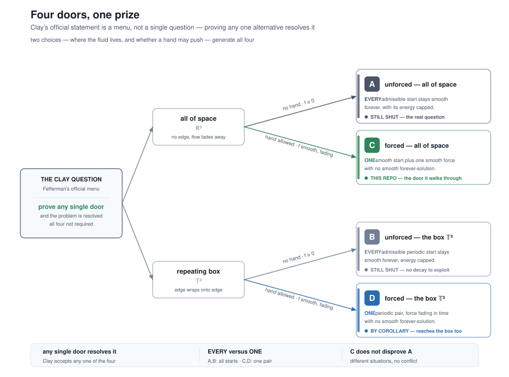

# THE BIG PAPER, FOR CAVEMAN

**A dumbed-down rewrite of:** *Statement-Design Arbitrage and Verification Limits: A Forensic Code Audit of the `openai/NavierStokesAndEuler` Repository*

**What this file is:** same findings, small words. Long words in **bold** are the paper's words, kept so caveman can point at the real paper and grunt.

**What this file is not:** new work. Caveman did not find new thing. Caveman only took paper apart and said it again with fewer rocks.

---

## 0. WHO IS WHO

- **The repo** = `openai/NavierStokesAndEuler`, commit `f9e8bc5`. Big pile of code. 641,332 lines. 2,659 files.
- **Lean** = talking rock that checks math. You give rock a proof. Rock says yes or no. Rock very strict about logic. Rock **not** strict about everything caveman cares about (more later).
- **The paper** = the audit. Two names on it, Abdelrahman El Sayad and John. They read the code line by line and wrote down what it does and does not prove.
- **Caveman** = you, reading this.

---

## 1. WHAT THE ROCK ACTUALLY CHECKS

The repo is written in **Lean 4**, on top of a big math library (**Mathlib**).

Good news first, because it is real:

- No **axioms** — no "just believe me" stones.
- No **`sorry`** that anyone can reach — `sorry` is Lean for "trust me bro."
  - There is one file with `sorry` in it, but nobody imports it. The file's own header says so. Dead rock.
- No **`native_decide`**, no **`unsafe`**, no **`partial`**, no **`implemented_by`** — these are all ways to sneak around the rock.
- Repo says nine other checkers independently said yes. Paper did **not** re-run them. Paper could not — no Lean on the audit machine.

So: the rock did its job. The question is not "did it compile." The question is **"what did the thing that compiled actually say?"**

That is the whole paper.

---

## 2. WHAT THE REPO CLAIMS TO PROVE

Skip the code. Here is the claim in caveman:

> Pick any **viscosity** ν > 0. That is how thick the fluid is. Water thin, honey thick. Pick any.
>
> Then there is a fluid flow — smooth, incompressible, squished into a finite box — that:
> 1. starts **completely still** (speed zero everywhere at t = 0),
> 2. sits still until t = 3/8,
> 3. never has infinite **energy** (energy stays bounded),
> 4. **but its top speed blows up to infinity** as t → 1.
>
> And for that same push (**force** f), there is **no** solution that runs smoothly forever with finite energy. Not one. Nowhere.

In paper words: `breakdownStatement` / `theorem_1_1`. Five lines of code. Comes from a much longer construction.

Caveman translation of the four fields:
- **u** = velocity = how fast fluid moves.
- **p** = pressure = how hard fluid pushes itself.
- **f** = force = outside hand stirring the pot.
- **K** = box the fluid is trapped in.

---

## 3. THE BIG TRICK: THREE JOBS, NOT ONE

The claim is two claims glued with "and." They cost wildly different amounts of work. This is the paper's first move, and it is the honest one.

### Job 1 — Naming the force. FREE.

Caveman have any flow u at all that blows up. Caveman say:

```
f := ∂t u + (u·∇)u − νΔu
```

That is just "whatever is left over." Caveman named the leftover "force." No equation solved. The equation is now **true by definition**, because caveman defined the unknown to be the leftover.

Paper calls this **Proposition 1**. It is not cheating. It is just: naming the force is free.

But naming it is **not** the same as it being nice. Which brings us to:

### Job 2 — Making the leftover smooth. EXPENSIVE. This is the construction.

The leftover f contains `∂t u`. And `∂t u` is **infinitely big** at t = 1, because the whole point is that u blows up.

So f is a pile of infinitely-big pieces that must cancel each other to every single order, exactly at the bad time. Getting a flow that blows up? Easy. Getting the **leftover** to stay smooth while the flow blows up? That is the actual hard part, and it is where the repo does its real building work.

The repo is honest about this. It takes smoothness of f as a **hypothesis** in `of_localized_fields` and passes it in. Not hidden. Just expensive, and done elsewhere.

### Job 3 — Proving nobody else has a solution. REAL MATH.

The second half says `¬ Nonempty (GlobalFiniteEnergySolution ν f)` — nobody has a global finite-energy solution.

That is a genuine **uniqueness theorem** (`classical_uniqueness_on_Icc`). And it is strong: the competitor only has to be smooth, divergence-free, agree with the same leftovers, and have finite energy. No pressure bound. No decay at infinity. No support condition. No growth condition.

And a tautological force buys none of that. A wrong force class would destroy it.

### The ledger

| Job | Cost |
|---|---|
| **Naming** the force | Free |
| **Smoothing** the leftover | The construction |
| **Comparison** (nobody else solves it) | The mathematics |

And the repo proves the force **cannot be zero**: `force_nonzero_of_no_global_solution` says if the force is supported only at positive time and kills all global solutions, then f is nonzero somewhere at t > 0. So the result really is "forced," not "spontaneous." Caveman cannot restate this with f ≡ 0.

---

## 4. FINDING ONE: ROCK CANNOT SEE HOW BIG A NUMBER IS

Here is the paper's first real finding. It has a long name: the **Non-Evaluated Constant Barrier**. Caveman words: *rock checks that a number exists. Rock does not check what number it is.*

### Three places it bites

**One. A constant borrowed from the library.**
`sobolevConstant` is defined as "whatever number Mathlib's proof coughed up." `noncomputable`. Nobody knows what it is. It gets used in a real inequality. Then `weightedSobolevConstant := 4 * sobolevConstant + 1` — also unknown.

**Two. A witness yanked out of an existence proof.**
Somebody proved *"there exists C > 0 such that the weight's second derivative is ≤ C."* Then:

```lean
def weightSecondDerivativeConstant : ℝ :=
  Classical.choose exists_weight_second_derivative_bound
```

`Classical.choose` = "grab the thing that the proof said exists." Caveman does not get to look at it. No equation defines it. Not reducible. Not computable. Not inspectable. It exists, and that is all caveman knows.

**Three. A pressure bound.** Best of the three, because the data-dependence **is** written out explicitly. But it is still `∃ C`, and the number is still not there.

### Why the rock cannot see it — in one idea

**Some numbers live in the TYPE. Those get checked. Some numbers live in the TERM. Those do not.**

**Checked: exponents that become indices.**
`Lp ℂ 6` and `Lp ℂ 4` are different **types**. If caveman tries to use a 6 where a 4 belongs, Lean has to solve `6 =? 4`. It fails. Compile error. Rock screams.

Also true for `ContDiff ℝ n` — the differentiability order — same story.

For these, the rock is a **complete decision procedure**. Get an exponent wrong, you cannot compile. Full stop.

**Not checked: constants in `∃ C`.**
Look at this:

```
∃ C : ℝ, 0 ≤ C ∧ ∀ x, ‖T x‖ ≤ C ‖S x‖
```

That is a **proposition**. To check a proof of it, the rock checks that the witness **inhabits** it. There is no second, independent spec for C. The proposition *is* the spec.

And every use in the repo is monotone in C — every occurrence is "≤ C × something" with C in positive position. So if C is replaced by 10⁶ · C, **every single statement stays true**. The rock cannot tell a right constant from an inflated one. It is not that the rock is bad. It is that nothing in the type theory asks the question.

The paper flags this itself: the monotonicity claim is a human argument about the scripts, **not machine-checked**. That is why the auditors had to check dimensions by hand.

### Is this fatal? No. And the paper is careful about that.

The headline theorem **contains no constant at all**. Its type is `∀ ν > 0, ∃ u ∃ p ∃ f ∃ K, ...` and the body of the claim is all qualitative: smooth, supported, divergence-free, satisfies the equation, speed unbounded, no global solution.

So no assignment of values to constants can make the headline false. The barrier is **epistemic, not logical**. The theorem is safe.

### What it does kill

| Caveman wants to claim | Rock says |
|---|---|
| "The proof gives an explicit bound" | **No.** Every constant is `∃`-bound or `choose`n. |
| "The bound is dimensionally consistent" | **Not checked.** Dimensions are not in the type theory at all. |
| "The constant is small enough for the next step" | **No.** No step ever plugs in a numeral. |
| "The exponent bookkeeping is right" | **Yes**, where the exponent becomes a type index or a reducible definition. |
| "The theorem holds" | **Yes**, if the kernel accepted it. |

### The contrast that proves the point

The repo **does** do exact quantitative work in one place: `ExponentLedger.lean`.

There, the gain is a **definition** built from exact rationals:

```
particularGain(σ, κ) = min( min( min(1/2 − 3κ, 1/2 − κ), 1/2 + σ − κ), 2/5 )
```

And `particular_gain_eq` **proves** it equals `2/5` when σ ≥ 1/5 and κ ≤ 10⁻⁵, by linear arithmetic on exact rationals.

That is checkable. Why? Because the number is a **definition of a real number**, not a witness of an existential. Equality with a numeral is decidable. The rock eats it.

Two footnotes caveman should not miss:
- **κ is never defined.** Every theorem says "for κ ≤ 1/100000." The file only checks that the numeral 10⁻⁵ satisfies that bound. So the repo verifies a **range**, not the manuscript's actual choice. (10⁻⁶ also works.)
- The tightest real margin is κ < 1/200. The value used is three orders of magnitude smaller. So the ledger is **consistent, not tight**. It is not claiming optimality.

---

## 5. FINDING TWO: FLUID SQUISHES DIFFERENT IN z THAN IN r

Long name: **Anisotropic Viscous Scaling under the generalized cone**. Caveman words: *the stretchy goo term is not one number. It is two numbers, and they are different.*

### The fancy coordinates

The paper uses **similarity coordinates** — the kind you use when you want to watch a thing blow up in slow motion.

- τ = 1 − t = time left until boom.
- q solves: `q − z² q^(2h) = τ`.
- Inner coordinates: `η = z / q^D`, where `D(h) = 1/2 − h`.
- And `X = s / q`, where s = r²/2 is a squished radius.

The **generalized cone** is the surface `|z| = q^D`. For 0 < h < 1/2, D is between 0 and 1/2, so this is a paraboloid-ish shape whose opening depends on h. At h = 0 you get the ordinary heat-equation cone back — but h = 0 is **outside** the allowed range.

### The pullback

Take any profile `f(X, η)`. Make it physical by multiplying by a weight:

```
(Φ f)(t, s, z) = q^b · f(X, η)
```

`b` is a real number. It is the weight.

### The derivative table (the heart of the finding)

Differentiate and see how the weight reacts:

| Derivative | Weight becomes |
|---|---|
| `∂s` | `b − 1` |
| `∂z` | `b − D(h)` |
| `∂s²` | `b − 2` |
| `∂z²` | `b − 2D(h)` |

Read the last two rows. **They are not the same.**

The Laplacian in these variables is `Δ = 2s ∂s² + 2∂s + ∂z²`. Work it through, being careful that `s = qX` is not constant:

```
Δ(Φ f) = Φ_{b−1}( 2X ∂X²f + 2∂X f )   ← radial part, degree b−1
       + Φ_{b−2D(h)}( Z Z f )         ← axial part, degree b−2D(h)
```

**Two homogeneous pieces. Two different degrees.** The difference is:

```
(b − 2D(h)) − (b − 1) = 2h
```

And 2h is strictly between 0 and 1 on the allowed range.

**Look at the picture:**



*Left:* the cone. Straight at `h = 0` (dashed — and excluded). Flatter as `h` grows, because the height shrinks like `q^D` while the radius shrinks like `q^(1/2)`.

*Right:* the two weights. Blue cannot move. Orange must move, by exactly `2h`. The shaded gap **is** the finding.

And the operator split, as a map:

```
              ONE LAPLACIAN
        Δax = 2s ∂s² + 2 ∂s + ∂z²
                    │
          ┌─────────┴──────────┐
          │                    │
       RADIAL                 AXIAL
     2s ∂s² + 2 ∂s            ∂z²
          │                    │
    degree b − 1        degree b − 2D(h)
      (fixed)             (moves with h)
          │                    │
          └─────────┬──────────┘
                    │
            gap = 2h  ∈ (0, 1)
```

**Caveman read the picture:** blue is flat, so the radial piece always eats one power of q. Orange climbs, so the axial piece eats `2h` **extra** powers — and since q < 1, more powers means smaller, so the axial piece is the **more damped** one. At `h = 0` the two lines meet. Every allowed `h` keeps them apart.

At h = 0 the two agree. At h = −1/2 the axial degree would be 2. **Both are outside the allowed range.** So on every single declaration the repo uses, the two degrees are **never** equal.

Which means: **no admissible member of this family is isotropic.** Not "might not be." Is not.

### Where did the mismatch go? The box ate it.

The cone is a **container**. Look at how volume scales:

- dz scales like `q^D`
- ds scales like `q`

So the measure element is `dz ds = q^(1+D) · (L/d) dX dη`. Then:

```
‖Φ f‖²_L² = q^(2b + 1 + D(h)) · (inner integral)
```

Cancel the q-power and you get the **critical weight**:

```
b*(h) = −(1 + D(h))/2 = −(3 − 2h)/4
```

At h → 1/2 that is −1/2. At h → 0 it is −3/4. The magic weight **moves with the cone's opening.** The cone is not decoration; it is what makes the anisotropy survivable.

### Why the rock cannot see THIS either

Same root cause, fancier clothes.

`b` is a **real number argument** to a definition. It enters as `q^b` via `Real.rpow`, whose type is `ℝ → ℝ → ℝ` **no matter what b is**. Change b to b − 2h? **No type changes. No unification problem. The rock cannot tell.**

`D(h)` is a definition. `2D(h) = 1 − 2h` is proved by `ring`. But **nobody ever states `2D(h) ≠ 2`**, because that is a statement about geometry, and the file's job was algebra.

So: the ledger is exact where it operates, on rationals. And completely silent where the geometry walks in. The anisotropy is **visible** in the code — four theorems with explicit weights. What is **absent** is any declaration that would **fail** if you treated the two as equal.

### Careful, caveman. Do not over-grunt.

The paper is explicit: **this is not a bug in the code.** The code's identities are correct. The finding is that **you cannot read the code isotropically.** If the prose says "νΔ acts with weight q^(b−2)," that statement is about the radial part only. The axial part has a different weight, and the code says so in four theorems.

Also: this does **not** say the construction fails to be self-similar. It says the **operator** is a sum of pieces of different degrees. Big difference.

---

## 6. THREE DOORS WHERE A BILL USUALLY ARRIVES — AND NOTHING IS OWED

When caveman builds a thing like this, three doors usually charge a fee: a boundary estimate, a matching estimate, a correction estimate. The audit kicked all three doors. **All three are free — but not because something is small. Because each one is replaced by an identity.**

Free things are fine. But it is worth knowing they are free, because "free" and "checked" are different.

### Door 1 — Pressure at infinity

Pressure is **non-local**: `Δp = ∂i∂j(uiuj)`. To integrate pressure against something, you normally must either assume it dies off at infinity, or restrict your competitors to compact support.

The repo does **neither**.

Why? Because the pressure never appears alone. It appears only multiplied by `∇χ_R`, a **cutoff function**, and a cutoff is compactly supported for every finite R. So **no integral over the sphere at infinity is ever written.** There is nothing to estimate.

What replaces decay:
- compact support of the **reference** u only,
- **finite energy** of the competitor v — that is the only quantitative input on v.

And the R → ∞ limit is taken on a **bound**, not on an integral identity. Look at the binder order in `exists_uniform_rate_bound`:

```
∃ D ≥ 0, ∀ R ≥ 1, ...
```

**D is chosen BEFORE R.** So D cannot depend on R. That is the whole trick. Everything left over decays visibly: `C₀/R²`, `C₁R⁻¹B^(3/2)`, `R^(−7/4)B^(3/4)`.

Verdict: no vulnerability. A decay lemma would be **dead code**. That is exactly why none exists to find.

### Door 2 — The switch-on at t = 3/8

The fluid is dead still until 3/8, then goes. Audit asked: is there an `if-then-else`? Is a derivative computed at the junction? Does smoothness get delegated to pieces?

**No, no, no.**

The junction is **one scalar multiplier in time**:

```
activatedVelocity u = λ(t) · u
```

That is it. Smoothness is inherited because C^∞ is closed under multiplication. Two sides agree **because the field itself is zero on the early slab** — every derivative of zero is zero. So every derivative matches trivially, without a single derivative ever being computed.

And `CandidateBreakdown.lean` — the file the review task named — contains **no smoothness proof of f at all**. That premise was just wrong. Smoothness lives in `compactForce_smooth` and `force_contDiff`, both one-liners.

Bonus: the force's time support is not asserted near the junction, it is kept **away** from it: `tsupp f ⊆ [1/16, 21/16] × K`. Since 1/16 > 0, that is what proves the force lives at positive time.

### Door 3 — Cutting a divergence-free field

The classic trap: cut a divergence-free field and it stops being divergence-free. `∇·(χu) = u·∇χ ≠ 0`. The standard fix is a **corrector** field. Audit asked: does the corrector exist? Does it eat powers of q? Is its leftover added to f or hidden in a constant?

**There is no corrector, and none is needed.**

Because the repo cuts the **potential**, not the velocity:

```
cutVelocity A = ∇ × (χ A)
```

A **curl has no divergence.** Identically. Always. `∇·(χu) ≠ 0` is a quantity that **never appears** in the development. There is nothing to correct.

Does the commutator just vanish? No — **it is carried, not cancelled**:

```
∇ × (χA) = χ(∇ × A) + ∇χ × A
```

That second term *is* the commutator `[∇, χ]`. It is **kept inside the velocity**. That is why the cut velocity is exactly divergence-free, while being only locally equal to `χ ∇×A`. On the plateau where χ ≡ 1, the commutator dies, and the identity upgrades to equality of all derivatives.

So both ledger questions dissolve: no corrector means no missing q-powers, and no corrector leftover means there is nothing to hide in f.

---

## 7. THE PACKETS AND THE ONE HIDDEN CHOICE

This part is about the **Euler side** — the construction of the blow-up itself. Slightly separate from the rest, but worth knowing.

### It is a packet, not a pulse

Search the code for "pulse" and "oscillat": **nothing**. No file name, no string. The object is called a **packet**. 1,839 files in `Euler/`, 110 of them `Packet*.lean` with support statements.

That matters! A scan for "pulse" reports the **absence of a name**, not the absence of a mechanism. Caveman who reports "no pulse found" has made a **false negative**, not a finding.

### The halving is proved, not assumed

`timeWidth` shrinks by at least half at every stage:

```
actualWidths_contract : timeWidth (n+1) ≤ timeWidth n / 2
```

Route: bound the width ratio by a finite series total, show ratio ≤ δ ≤ 1/2, convert. No limits. No compactness. Finite arithmetic.

There is **one conditional link**: `horizonTime_antitone` carries the halving as a **hypothesis**, and that file does not import the file that proves it. Read alone, it is conditional. The join is made elsewhere, through the `StageGuards.next_width` field, which is filled by `actualWidths_contract`. So citing it as unconditional **overstates by exactly one import**. The paper says so.

### Three things this is NOT

1. **Not a dimensional law.** Both the grading and the shrinking come from the same `scaleSequence`, controlled by a summable cost series. Not from differentiating a scaling ansatz. So it is **not evidence** either way on the anisotropy question in §5.
2. **Not the spatial support.** Spatial radius is `supportScale`, exponent **7/2**. Time width exponent is **7**. Two different objects. A claim about one is not a claim about the other.
3. **Not collapse to a point.** The intervals nest from both ends — but `common_positive_interval` proves the intersection has **positive length**. Nesting is used to keep one common interval available, not to squeeze it shut.

### The root: one `Classical.choice`

Whole chain:

1. **`exists_scales`** — proves some scale record exists, from nothing but 0 ≤ c.
2. **`constructionScales`** — `Classical.choice` grabs it. **One line. This is the root.**
3. **`packets`** — built from that record.
4. **`initialDatum`** — the limit of the packets.
5. **`lifespan`** — a **second** `choose`, downstream, not a competing root.
6. **Top level** — `initialDatum_singularity`, `exists_compact_smooth_euler_singularity`.

The chosen record holds four numbers: **J, D, X, δ**. No computable content. Every downstream quantity — every width, every horizon, every frequency — is defined from that one opaque grab.

### What this means

**Logical closure, numerical opacity.**

Correctness is not lost. Every lemma is polymorphic over the scale record and uses only its fields, so nothing is assumed about a hypothetical one. The theorems really are about the actual object.

What **is** lost is **recoverability**. Caveman cannot extract a number for the first width, or J, or the base horizon, out of the statement. The choice **is** the construction. You cannot expose the witness without exposing which witness was chosen.

This is the same barrier as §4, at a coarser grain. There it hid behind individual constants. Here it covers the **entire scale regime**.

One thing it does **not** do: the chosen D does not cap the derivative order. It enters only at index zero, and there is no upper bound on D anywhere.

---

## 8. SO WHAT DOES THE THEOREM ACTUALLY SAY?

One sentence:

> **A smooth force, squished into a finite box, can drive fluid from rest to infinite speed with no global finite-energy solution.**

Now the important part. The Clay Millennium statement has alternatives. This matches **(C)**:

- Zero is an **admissible** initial datum. ✅
- A smooth compactly supported force is **stronger** than Clay's rapid-decay requirement. ✅

So: **if the proof is correct, it resolves (C).**

It does **not** touch:
- **(A)** — the unforced case.
- **(B)** — the forced case without that force class.

And the repo's own `force_nonzero_of_no_global_solution` is the formal proof that you **cannot** restate this with f ≡ 0. That is precisely why it bears on (C) and not on (A).

Whether the proof is correct, and how CMI judges it — **the paper does not decide.** The paper audits what the code certifies, not whether the prize is won.

---

## 9. WHAT THE PAPER DOES **NOT** SAY

Caveman should be very careful here. The paper has an explicit non-claims appendix, because people will misquote it.

1. ❌ **Not** "the repo is unsound / has a hidden axiom / proves something false." The verifications point the **other way.**
2. ❌ **Not** "Lean or Mathlib is to blame." Same theorem in prose would have the same problems. The kernel behaved exactly as specified.
3. ❌ **Not** "the comparison theorem is weak or circular." It is, in the auditors' judgment, **the strongest part** of the whole development, with near-minimal hypotheses.
4. ❌ **Not** "the anisotropy is an error in the code." The code's identities are **correct**. The finding is that an isotropic **reading** is incompatible with them.
5. ❌ **Not** "the whole repo is 641,332 lines of comparison argument." That is the whole tree. The comparison chain is a small slice.

---

## 10. THE HOLE IN THE AUDIT ITSELF

Caveman respects a paper that lists its own weak spots.

- **Findings not recompiled.** Every finding is from reading proof terms, binder order, and definitions.
- **But the proof was.** On Linux: `lake build NavierStokes` finished 9,580 jobs, exit 0, 817 modules. The four whole-space theorems lean only on `propext`, `Classical.choice`, `Quot.sound`. On this Mac the build tool dies inside Apple's memory allocator, so the build ran in a Linux box. That checks **terms**, not **statements** — the findings above are still read, not machine-checked.
- **Nine external checkers were reported by the repo. One of them was run, on both questions the repo asks — the flood one (E75) and the Euler one (E79).** Comparator takes the question the repo poses (the `sorry`-holed challenge file) and the answer, exports both, checks they are the same question, and replays the answer in a fresh kernel. It said `Your solution is okay!` (E75). The other eight were still not re-run. And even a passing check verifies **terms against that question**, not that the question is Clay's own: the statement-level objections (zero datum, force-as-leftover, similarity in ν) are exactly what no checker can test. For the Euler question the caveat is smaller (E80): that question **is** the repo's own, because the repo's index file names those two declarations as its Euler theorems, and the words the challenge uses are proved to say the same thing as the words the builder uses. For the flood question the caveat still bites, because the repo's index points at the repo's own statement, not at Clay's paper. E81 now holds it there, and finds one soft spot: the paper says the **slope** runs away; the checked question says slope **plus speed** runs away, which is easier, because a sum can run off when only one of its parts does. The cave proves the harder thing anyway (`maximalGradientNorm_limsup`), but the question the checker accepted does not ask for it. So the Euler check is honest and two clauses soft — and the paper's own sentence is not what the kernel nodded at. E82 found the second: the paper's bad time is when its **fully smooth** river dies; the cave measures the bad time in a bigger pool of rivers that are only smooth in space, with a weaker kind of clock. Nobody proved the pools are the same size, so the formal bad time belongs to the bigger pool.
- **Two identities in §5 are the auditors' own** — the measure scaling and the critical weight `b*`. Not in the repo. Labelled as derived.
- **One early log entry (E36) is provisional.** Call site and estimates checked; exact binder not opened. Later entries walked the same estimate chain from the other end (E67–E71) and found no assumed field, but they did not reopen that binder.
- **Since this file was first written, the audit got further.** The smooth-force question is answered (E65–E66), the estimate chain is walked to its floor (E67–E71), the ring-world is audited (E70), and the print that confirms its harmless stones was found in the source (E72) and then actually run on a rented machine (E73). Nothing is left unread, and nothing is left unrun except the second rock (nanoda), which is a different tool.
- **The monotonicity argument in §4 is not machine-checked.** It is a human claim about the scripts.
- **One erratum was not read at first hand.** The pressure-periodicity attribution rests on the repo's reference and secondary descriptions. Correctly attributed, not independently verified.

---

## 11. BIG WORD → CAVEMAN WORD

| Paper says | Caveman says |
|---|---|
| Viscosity ν | How thick the goo is |
| Velocity field u | How fast goo moves where |
| Pressure p | How hard goo pushes itself |
| Force f | Outside hand stirring |
| Divergence-free | Goo does not bunch up or spread out |
| Compact support | All the action is inside a box |
| Smooth / C^∞ | No corners, no kinks, forever |
| L² / finite energy | Total wiggle stays finite |
| L^∞ blows up | Top speed goes to infinity |
| limsup | The highest it keeps coming back to |
| Existential `∃` | "Some number exists, no I will not show you" |
| `Classical.choose` | "Grab the thing the proof said exists" |
| `noncomputable` | "You cannot calculate this" |
| `sorry` | "Trust me bro" |
| Axiom | "Just believe me" stone |
| Kernel | The tiny rock brain that checks proofs |
| Type index | A number in the label on the box. **Checked.** |
| Term constant | A number inside the box. **Only counted, not weighed.** |
| Unification | Rock checking that two labels are the same |
| Homogeneous weight | Which power of q a derivative eats |
| Isotropic | Same squish in every direction |
| Anisotropic | Different squish in different directions |
| Pullback | Rewriting the goo in stretchy coordinates |
| Corrector field | Patch you bolt on when cutting breaks a promise |
| Commutator `[∇, χ]` | The error the cutoff introduces |
| Germ equality | Two things agree in a tiny neighborhood |
| Dominated convergence | A limit that is allowed to sneak inside |
| `sorry`-free | No trust-me-bro anywhere reachable |
| Machine-checked | The rock said yes to the **logic**, not to the **numbers** |

---

## 12. THE WHOLE PAPER IN FIVE LINES

1. The repo is **logically clean**, and the theorem it proves is **true if the rock said yes to it**. This audit read the proof; it did not re-prove it from scratch.
2. But the rock only audits arithmetic that is **in the types**. Constants and real exponents are **not** in the types, so the rock is **blind** to their size and dimension.
3. So: no explicit bound, no dimension check, no "small enough" claim — and the construction hides its whole scale regime behind one `Classical.choice`.
4. Separately, the repo's own derivative identities prove the viscous term is **two pieces with different weights**, differing by 2h, and **no allowed member is isotropic** — even though the code is correct and the ledger never notices.
5. The theorem matches Clay alternative **(C)**, not (A) or (B), and the audit does not judge whether the proof wins the prize.

**Bottom line for caveman:** the rock checked the **shape** of the argument. It did not check the **size of anything**. Those are different things, and "machine-checked" only promises the first one.

---

## 13. THE EQUATION ITSELF, ONE SYMBOL AT A TIME

Everything above was about the **proof**. This part is about the **equation** — the thing being proved. Same treatment: big word, then human, then caveman.

### What the repo actually writes

From `NavierStokes/R3/ProblemStatement.lean:57`:

```lean
def navierStokesResidual (ν : ℝ) (u : VelocityField) (p : PressureField)
    (t : ℝ) (x : Space) : Space :=
  temporalDerivative u t x + advection u t x
    - ν • spatialLaplacian u t x + pressureGradient p t x
```

Written the way a physicist writes it:

```
∂ₜu  +  (u·∇)u  −  νΔu  +  ∇p  =  f
```

And the second equation, which is not optional:

```
∇·u = 0
```

That is the whole Millennium Problem. Four terms and a constraint.

**Layman:** a balance sheet for the speed of a drop of fluid. Left side: the four things that change its speed. Right side: whatever outside hand is pushing it.

**Caveman:** how fast goo goes changes because goo drag itself, goo rub itself, goo push itself, and hand push.

### The picture



*One equation, four jobs. **(a)** the clock measures; **(b)** advection sharpens — the spinning tube thins and must spin faster, and nothing pushed it; **(c)** viscosity smooths, and the minus sign is the whole point, because it only ever removes energy; **(d)** pressure is not tracked, it is solved from the velocity everywhere at once. The band at the bottom is what the four terms are **not** allowed to break: `f` is the only door energy comes in through, and `∇·u = 0` is a rule none of them may violate.*

### The card

| Symbol | Name | What it does, human | What it does, caveman |
|---|---|---|---|
| `∂ₜu` | **time derivative** | How fast the velocity *at one fixed point* changes as you stand there watching | Does this spot get faster or slower right now |
| `(u·∇)u` | **advection** / **convection** | The fluid carries its own velocity along with it. Speed moves speed | Fast goo grabs slow goo and drags it. Fast makes faster |
| `−νΔu` | **viscous diffusion** | Sticky friction between neighbouring layers. Rubs the fast parts against the slow parts | Goo is sticky. Rubby bits slow down the slippery bits |
| `∇p` | **pressure gradient** | The fluid shoves itself. High pressure pushes toward low pressure | Goo squeeze here, bulge there |
| `= f` | **body force** | Whatever the outside world is doing: a stirrer, a pump, gravity | Hand in the pot |
| `∇·u = 0` | **incompressibility** | No bunching up, no spreading out. What flows into a spot flows out | Goo cannot be made or lost in a place. In equals out |

### Term by term, for humans

**`∂ₜu` — the clock term.**
Nothing physical yet. It just measures change. If you painted a dot on the wall and watched the fluid pass it, this is how the speed at that dot changes. Caveman: *the spot's mood, right now.*

**`(u·∇)u` — the villain.**
This is the only term that can make the fluid faster **on its own**, with no help. It says: the fluid is carried by the fluid. In Lean it is literally `spatialDerivative u t x (u (t, x))` — take the derivative of the velocity, then feed the velocity into it.

Why it is dangerous, human version: a spinning tube of fluid gets stretched thinner by its own spin, and a thinner tube must spin faster to conserve angular momentum. Ice skater pulling her arms in. Nothing pushed her. She just got faster.

Why it is dangerous, caveman: spinny goo gets skinny, skinny goo spins harder, harder spin makes skinnier. Goo does this to itself.

This is called **vortex stretching**, and in three dimensions it is the entire reason the problem is unsolved.

**`−νΔu` — the referee who is always late.**
Viscosity smooths. It takes sharp differences in speed and blurs them out. Honey does this; water does it less. The minus sign matters: it *removes* energy, always, never adds.

Caveman: sticky goo hates fast-bumpy goo. Sticky goo always win in the end — but it takes time, and the bumpy goo is getting bumpier.

**`∇p` — the ghost.**
Pressure is not a separate thing you track. It is determined *instantly* by the velocity, through a hidden equation:

```
Δp = −∂ᵢ∂ⱼ(uᵢuⱼ)
```

Push the fluid here and pressure reacts over there, with no delay. That is why pressure is called **non-local**: it is a global bookkeeper enforcing `∇·u = 0` everywhere at once.

Caveman: goo shout across whole pond at once. Squeeze one rock, other rock answers same time. No runner carries message.

**`f` — the hand.**
Whatever is doing the pushing from outside the fluid. In the classic problem, `f = 0` (nobody stirs). In *this* repo, `f` is the whole trick — see §3.

Caveman: hand in pot. Repo bring own hand.

**`∇·u = 0` — the rule that cannot break.**
Incompressible means the fluid is not squishable. Volume is conserved. This is the constraint that makes the other four terms hard, because every term must respect it simultaneously, and pressure is the enforcer.

Caveman: no extra goo appear, no goo vanish. In equals out, always, everywhere.

### What "blow-up" actually means here

This is the part most people get wrong, so slow down.

Caveman expects "explosion" = more and more energy. **That is not what this theorem says.** The energy is **bounded** the whole time: `∃ E, ∫|u|² ≤ E` for every t.

What blows up is `‖u‖_∞` — the **fastest point** — while the **total** stays capped.

**Human:** if total sloshing is capped but one point's speed is unbounded, that point must be concentrating into a smaller and smaller region. Total water in the pond is fixed; the jet is getting thinner and faster.

**Caveman:** pond have same amount of splash whole time. But one spot splash infinitely hard. So spot must get tiny. Same water, narrower jet.

That is exactly why the theorem needs the **box** `K` and why §5's **cone** matters: the blow-up is a narrowing, not an inflation. The box catches the narrowing; the cone says how fast it narrows in each direction.

### And where the energy comes from

Multiply the equation by `u` and integrate. The pressure term dies (because `∇·u = 0`), and what is left is:

```
d/dt ( ½∫|u|² )  =  − ν∫|∇u|²  +  ∫ f·u
```

**Human:** the energy can only change two ways — friction destroys it (always negative, always), or the outside force adds it. With `f = 0`, total energy can **never go up**. It can only fall.

**Caveman:** goo splash only go up if hand push. No hand, splash always go down. Always.

That one line explains the whole shape of the field:

- **Unforced (A):** energy cannot rise. Any blow-up has to come from the fluid *reorganising* fixed energy into a thinner and thinner jet. That is the unsolved case. Nobody knows if it can be done.
- **Forced (the repo):** the hand can pump. Now blow-up is easy to get. The hard part is making the hand **smooth** while the fluid misbehaves, which is §3's expensive construction.
- **The repo's own constraint:** it keeps the energy bounded anyway. So even its force is not flooding the pond — it is squeezing the same water harder.

---

## 14. WHY THREE DIMENSIONS IS THE HARD ONE

### The fight

Three things want different things:

| Player | Wants | Power |
|---|---|---|
| **Viscosity** `νΔ` | Everything smooth and boring | Strong on fast wiggles: it eats mode `k` at rate `νk²` |
| **Advection** `(u·∇)u` | Sharper, thinner, faster | Moves energy from big slow swirls into small fast ones |
| **Pressure** `∇p` | Enforce `∇·u = 0` and nothing else | Non-local; it can cancel advection *partly*, never fully |

**Human:** viscosity smooths, advection sharpens, pressure referees. If viscosity wins, the fluid stays smooth forever. If advection wins, speed goes to infinity in finite time. The entire Millennium Problem is: **who wins?**

**Caveman:** smooth goo fight rough goo. Referee goo in middle. If smooth win, no boom. If rough win, boom.

### In flat land, smooth always wins

In **two** dimensions this fight is settled. It was solved in the 1930s: smooth initial data stays smooth forever. No blow-up, ever.

The reason is a conservation law that only exists in 2D: vorticity (the spin) is *carried* but never *stretched*. The ice-skater trick needs a third dimension to work. In flat land there is no thinning, so the skater cannot pull her arms in, so the spin cannot run away.

**Caveman:** flat goo has no way to get skinny. No skinny, no spin-fast, no boom. Flat goo always safe.

### In three dimensions, nobody knows

In 3D the stretching is available. So the fight is genuinely undecided, and that is the million dollars. There are two ways it could end:

- **Some smooth start blows up in finite time** → the equations are incomplete as a physical model; nature would have to pick a different rule at the singularity.
- **No smooth start ever blows up** → the equations are complete, and every solution is smooth forever.

Nobody has proved either. That is not a gap in effort; it is a known open problem with a prize on it.

**Caveman:** in 3D, skinny goo maybe win. Nobody know. Smart rock people fight 90 years. Still no answer.

### What this repo does — said honestly

This is where people get excited and say wrong things, so be careful.

The repo does **not** settle the fight. It does not show that unforced fluid blows up. It shows something narrower and precise:

> If you are allowed to choose the outside hand `f`, there is a smooth hand and a smooth start that force a blow-up, and no smooth forever-solution exists for that same hand.

**Human:** it does not prove that the fluid is dangerous on its own. It proves that the fluid *can be driven* into a singularity by a force that is itself perfectly well-behaved — no kicks, no infinities, no cheating in the force. That is Clay alternative **(C)**, not (A).

**Caveman:** repo not say goo boom by itself. Repo say goo boom if hand push in a very smooth clever way, and no other goo with same hand survive. That still big. That not the same as no-hand boom.

And the repo's own code proves the hand cannot be empty: `force_nonzero_of_no_global_solution` — if `f` is supported only at positive time and kills every global solution, then `f` is nonzero somewhere. **You cannot restate this theorem with `f = 0`.** The Lean itself refuses.

### The one-sentence version of the equation

> **Speed changes because the fluid drags itself, rubs itself, and shoves itself — and whoever is outside decides whether that ends in calm or in a singularity.**

Caveman: **goo moves because goo drag goo, goo rub goo, goo push goo. Hand outside decide if goo calm or goo boom.**

---

## 15. THE CLAY QUESTION: FOUR DOORS, YOU ONLY NEED ONE

People say "the Navier–Stokes problem" like it is one question. It is not. Clay's official statement is a **menu of four questions**, and the rules say: prove **any one** of them and the problem is resolved. You do not have to prove all four. You do not have to prove the strongest one.

Fefferman's official description says the four options give "reasonable leeway to solvers while retaining the heart of the problem." That sentence is the key to the whole thing. Clay deliberately made four doors because one door was too narrow to walk through.

### The rules of the game

Before the doors, the rules. These are the same for every door:

| Rule | Condition | Human | Caveman |
|---|---|---|---|
| Starting flow | (4): `\|∂ᵅu₀(x)\| ≤ C/(1+\|x\|)^K` | Smooth, incompressible, and dies off faster than any power at infinity | Starts fast enough nowhere, and fades at the edges |
| Force | (5): `\|∂ₓᵅ∂ₜᵐf\| ≤ C/(1+\|x\|+t)^K` | If a hand is allowed, it must be smooth and fade away in both space and time | If hand exists, hand must be gentle and let go |
| Solution | (6): `u, p ∈ C^∞(ℝ³ × [0,∞))` | Smooth for **all** future time. No corner, no kink, no infinity, ever | Goo smooth forever. Never breaks |
| Energy | (7): `∫\|u\|² < C` for all `t ≥ 0` | One single number caps the total sloshing, at every time | One number cap the whole pond, always |

**The important bit:** a "solution" means smooth **forever** with **capped** energy. Not smooth for a while. Not smooth with energy that creeps up. Forever, and capped. That is a very strict club to get into — which is exactly why it is easy to prove that something is *not* in it.

### The four doors

| Door | Where | Hand allowed? | What you must show |
|---|---|---|---|
| **A** | all of space `ℝ³` | **No** — `f ≡ 0` | **Every** allowed start stays smooth forever, with bounded energy |
| **B** | repeating box `𝕋³` | **No** — `f ≡ 0` | **Every** allowed periodic start stays smooth forever |
| **C** | all of space `ℝ³` | **Yes** — smooth, fast-fading `f` | **One** allowed start plus one hand, for which **no** smooth bounded-energy forever-solution exists |
| **D** | repeating box `𝕋³` | **Yes** — smooth, fading in time | **One** allowed periodic pair with **no** smooth periodic forever-solution |

Two choices make four doors: **where** the fluid lives (infinite space, or a box that repeats forever), and **whether a hand is allowed**.

### The picture



*Read it left to right. The first fork is **where** the fluid lives; the second, written on the branches, is **whether a hand may push**. That gives four leaves. The two grey doors ask for a proof about **every** admissible start. The green and blue doors ask for **one** counterexample pair. A and B are shut; the audited proof walks through C, and reaches D by corollary.*

**Caveman:** first ask where goo live. Then ask hand or no hand. Four leaf come out. Grey leaf want all goo safe — big rock to lift. Green and blue leaf want one goo boom — small rock, and caveman bring own hand.

### The two words that decide everything: EVERY and ONE

This is the whole asymmetry, and almost nobody explains it.

**A and B say EVERY.** "Take any allowed start you like. I will show it never blows up." That is a statement about *all* of fluid dynamics. To prove it you must handle every possible starting flow, including the ones nobody has thought of yet. You cannot test your way there. You cannot pick a nice one.

**C and D say ONE.** "There exists one allowed start and one allowed hand for which it blows up." You get to **choose** the setup. One counterexample. That is a claim about a single pair of objects.

**Layman:** A is "no house in this city can ever catch fire." C is "here is one house, and I set it on fire myself." Those are not the same size of claim, and only one of them lets you bring your own matches.

**Caveman:** Door A say *every* goo safe. Door C say *one* goo boom, and caveman get to bring own hand. Different size rock.

### Door A — the real question, and nobody has opened it

**Layman:** no outside force at all. Every smooth, fast-fading, incompressible starting flow stays smooth forever and its total energy never exceeds some fixed number. If this is true, the equations are a complete description of water: nothing you can do to a fluid makes the mathematics break.

**Caveman:** no hand ever. Every goo, from every start, stay smooth forever, splash capped. Goo never break. Nobody prove this. Nobody disprove this either.

This is the door most people mean when they say "solve Navier–Stokes." It is untouched.

### Door B — same question, but in a box that repeats

The periodic box `𝕋³` is space with the rule "walk off the right edge, come back on the left." No boundaries, no infinity to worry about, but no decay either — the flow wraps around instead of fading.

**Layman:** the same universal claim as A, but on a torus. It is not easier in the way people hope; it removes the decay at infinity, which removes a tool, and it keeps the vortex stretching, which is the danger.

**Caveman:** same as A but goo live on a ring-world. Walk off edge, come back other side. Still no hand. Still every start. Still nobody know.

One detail that shows how careful the official text is: an **erratum** requires the pressure to be periodic too, not just the velocity. Small print, but it is the kind of small print that decides whether a proof matches the question.

### Door C — breakdown, with a hand allowed

**Layman:** there exists a smooth allowed starting flow and a smooth allowed force, both obeying the decay rules, such that **no** smooth finite-energy solution exists for all time. You only need one. And because a force is allowed, you are permitted to push the fluid yourself.

**Caveman:** hand allowed. Caveman pick one smooth start and one smooth gentle hand. Then: goo boom, and no forever-goo with same hand exist anywhere. One is enough. Rock say yes, caveman win.

This is the door the audit's subject walks through.

### Door D — the same, in the periodic box

**Layman:** one allowed periodic start and one allowed periodic force, fading in time, with no smooth periodic solution forever. Same shape of claim as C, different arena.

**Caveman:** C, but ring-world, and the hand must fade away as time go on. Still only need one.

### The trap that catches everyone

**C is weaker than "A is false."** Not equal to it. Weaker.

Because C lets you choose the force, proving C does **not** disprove A. Both of these can be true at the same time, with no contradiction anywhere:

- Every unforced flow stays smooth forever (A true), **and**
- Some forced flow blows up (C true).

There is no conflict, because they are about different situations. A car that never breaks down when parked does not contradict a car that breaks down when you drive it into a wall.

**Caveman:** goo never boom by itself, but goo boom if hand push bad enough. Both can be true. No fight between them.

So the honest sentence is: **a proof of C resolves the Clay problem as posed. It does not answer the unforced question.** Those are two different achievements, and conflating them is the single most common error in coverage of this result.

### What the repo actually hits

Match the repo's theorem against the four doors:

| Requirement for C | What the repo has | Pass? |
|---|---|---|
| Admissible start (4) | `u₀ = 0` — smooth, divergence-free, decays trivially | ✅ |
| Admissible force (5) | Smooth, compactly supported in space **and** time | ✅ stronger |
| Conclusion: no `(u,p)` in (6)–(7) | `¬ Nonempty (GlobalFiniteEnergySolution ν f)` | ✅ |
| For every `ν > 0` | The ν-rescaling chain | ✅ |

A compactly supported smooth force satisfies (5) automatically: outside a compact set it is exactly zero, so every derivative is bounded, and a bound is all (5) asks for. So the data checks are easy — and that is the point: **checking the data class does not verify the proof.** It only verifies that the statement is aimed at the right door.

And the corollary pushes the construction into the periodic box, which aims it at **D** as well.

### Why the prize is about energy

One line explains the whole difficulty, and it is worth seeing once:

```
½‖u(t)‖² + ν ∫₀ᵗ ‖∇u(s)‖² ds  ≤  ½‖u₀‖²
```

**Layman:** the energy you start with is a budget. Friction spends it. What is left over is capped by what you began with. That sounds like exactly the control you need — and it is not enough.

The equation is **scale-invariant**: if `u(x,t)` solves it, so does `λu(λx, λ²t)`. Under that scaling the energy changes by a factor of `λ⁻¹`, so **energy can be made arbitrarily small by zooming in**. The natural energy estimate therefore cannot see the small scales, because on those scales everything looks free. The critical quantity that *does* scale correctly is the `L³` norm, and controlling `L³` for all time is the open problem.

**Caveman:** the ruler Clay hand you is too short to measure a splinter. Goo can always hide a sharp bit between the marks. That not a flaw in the ruler — it a fact about how goo shrink.

This is called being **supercritical**, and it is why 90 years of technique has not closed door A.

### The four doors, in one breath

> **A:** no hand, every start, prove calm forever.
> **B:** same, in a box that repeats.
> **C:** hand allowed, find **one** start where it breaks.
> **D:** same, in a box that repeats.
>
> **Any one wins. The repo goes for C, and reaches D by corollary. A and B are untouched.**

Caveman: **A** — no hand, all goo safe. **B** — same, ring-world. **C** — hand okay, find one goo that boom. **D** — same, ring-world. **One door enough. Repo kick C, also kick D. A and B still shut.**

---

---

## 16. WHAT CHANGED AFTER CAVEMAN WROTE THIS (E65–E75)

Caveman wrote this file first. Then the audit kept digging. Four things got better. Caveman writes them down so the two papers do not disagree.

### 16.1 The smooth hand — it is built, not wished for (E65, E66)

First paper said: the last assembly gate takes "hand is smooth" as a given. True that the gate takes it. But caveman had not walked upstream. Upstream: the cut hand is smooth because smooth times smooth is smooth (`compactForce_smooth`), the time switch is smooth the same way (`force_contDiff`), and the limit data the gate really needs (`hlim`) is **built**, not handed over — jets vanish at the bad point, the boundary limits come out locally uniform, and that is what feeds the gate. Nobody stamped the parcel at the door. It came up from the basement.

Caveman also had one wrong idea: caveman thought `meanSolve` and `highSolve` were the basement. They are not in this tower at all. They belong to Euler. Different building, no door between them.

### 16.2 The estimate chain — walked to the floor (E67–E71)

First paper said: the numbers are existential and never weighed. Still true. What changed is everything under it. The chain is now read all the way down: `StageEstimates` ← `RawStageBounds` ← current mode bounds ← native jet bounds ← **one wave-class fact about the actual source**. And that fact is not assumed — it is proved for the starting state and **rebuilt** every cycle by `assemble`, which caveman opened and found to be a structure literal: every field built, carried with a reason, or already proved before the call. No `sorry`. No field that quietly means "trust me bro".

Caveman: the floor is poured, not painted on. The numbers sitting on the floor are still "some number, somewhere" — that is finding one, and finding one did not move.

### 16.3 The ring-world got its own audit (E70)

"The periodic corollary follows" used to be a sentence. Now it is read: same theorem, clock squished, box repeated, and the competitor class is even **bigger** (it asks for no energy bound at all), bridged to the official Comparator statement in both directions. One honest footnote: in a repeating box nothing can be compactly supported, so the file says "support inside the box" — and it says so out loud, in the header.

### 16.4 The stone-print — found, then run (E72, E73)

First paper said: the periodic axioms were never printed. Then the print was found **already in the source**: `ComparatorSolution.lean` ends with `#print axioms` on both C and D, and `ComparatorChallenges/NavierStokes.json` names both theorems and allows only the three harmless stones. That was a claim, not a receipt, and a CI workflow was written to run it on a rented Linux box instead of this Mac.

Then it ran. Clean copy of the tree, nothing left over, 9,580 jobs, green. All five stamps came back the same — `propext`, `Classical.choice`, `Quot.sound` — and no `sorryAx` anywhere (E73). The three stones are the ones the config allows, so nothing had to be waved through. Caveman's receipt is in the artifact called `kernel-check-logs`.

Then the **official** question-checker ran, and it is a different animal from `#print axioms`. Comparator takes the question the repo poses (`ComparatorChallenges/NavierStokes.lean`, the one with `sorry` holes) and the answer (`ComparatorSolution`), exports both against the same list of names, checks they describe the same statement, and replays the answer in a clean kernel. It said `Lean default kernel accepts the solution` and `Your solution is okay!` (E75). Both theorems are in that list, so one pass covers the whole-space and the torus question at once.

Why it took so long to hear that: caveman had wrapped the runner in a pipe nobody drained. The tool was shouting into a blocked cave for 210 minutes, then 355. Nothing was slow. Same work, once the pipe was fixed: **7 minutes** (E74, E75).

And the **second** rock got thrown too. Its own step, its own log, and a checker built by other people in another language: nanoda replayed the same exported proof and said `nanoda kernel accepts the solution`. Then Lean's own kernel said `Lean default kernel accepts the solution`, then `Your solution is okay!` (E75 §7). Two kernels, different code, same answer.

### 16.5 The question itself got checked (E76, E77)

Comparator proved the answer matches **the question the repo asks**. It cannot prove the repo asks **Clay's** question. So caveman took Clay's six-page paper, downloaded it, put it next to the file, and went clause by clause.

Eleven numbered conditions. Every one has a home in the Lean file. Not one is missing, not one is softened: same equation, same no-bunching, same start-from-rest, same "decay faster than any polynomial" for the start and for the hand, same bounded energy on all of space, same smooth-forever, same repeating box, same hand that fades in time, same repeating pressure — and that pressure line is on the paper's own errata page, and the file has it.

Two spots where the file says the same thing in a different accent: "smooth on the closed half-space" is written as smooth-on-the-set, and "every derivative decays" is written as the size of the whole derivative, which is at least as big as any single piece, with the free constant soaking up the difference. Both are the honest reading, and both are written down now instead of assumed (E76).

Caveman also found a corridor nobody walks: `WaveInputs` and the two endpoint helpers that feed it have no caller anywhere. Not a hole — a spare corridor. Written down so the next reader does not think the proof leans on those eight fields (E77).

---

### 16.6 The Euler question got the same treatment (E79)

Everything above checked the flood question. The repo asks a second one, on the **Euler** side: no stickiness, no hand, and the claim is that a smooth start can come apart in finite time. That question has its own challenge file, its own two `sorry` holes, and its own answer — and nobody had run it. So it ran.

Cost first, because caveman had no idea: the Euler tower had to be built from nothing on the machine, **10,603 jobs, 50 minutes**. Then the same tent, the same carve-out, the same two stones: Comparator said `Lean default kernel accepts the solution`, nanoda said `nanoda kernel accepts the solution`, and the run ended `Your solution is okay!` on both. The two Euler stamps — the plain break, and the sharp one that names the exact moment the thing tears — depend on **only** the three allowed stones and no `sorryAx`.

What that means in caveman: the two Euler answers do prove the two Euler questions, and two different brains agree. What it does **not** mean: caveman read **zero** lines of the Euler proof's inside. Not one estimate, not one constant. The Euler side is now checked at the door and at the judge, and nowhere else. Said plain so it cannot be read as more.

*Source: `MANUSCRIPT.tex` and `PHASE2-FINDINGS.md`, at commit `f9e8bc5`, plus the audit log through E79. If this file and the paper disagree, the paper is right and caveman is wrong.*
